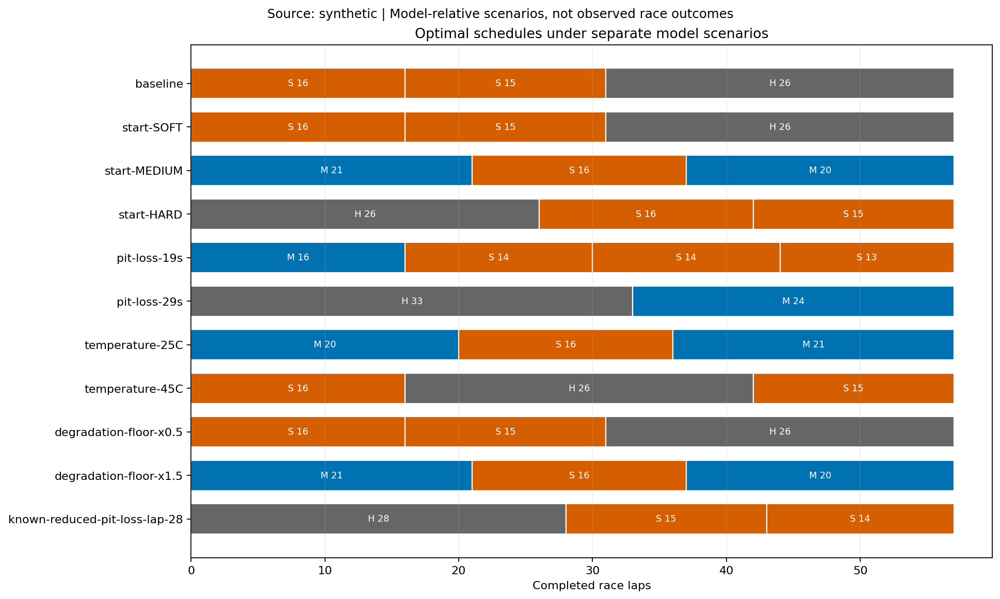

# F1 进站策略优化器

[接入契约与离线门控](docs/observation-ingestion-contract.zh-CN.md)：v1 默认；v2 实验未通过；接收时间与历史假设延迟分开。

[动作条件模型 v2 实验结果](docs/action-model-v2.zh-CN.md)：三场冻结评估精度未通过，覆盖提高；未替换默认模型。

[Freshness / 新鲜度与比利时独立验证](docs/freshness-validation.zh-CN.md)：候选未达预注册精度门槛；历史研究用途。

[Focused value/quality review · 实际价值复核](docs/value-review.zh-CN.md): prefix-based participant selection, conservative target ranking, verified offline exports; historical research only.

[本地交互网页工作台](docs/workbench.zh-CN.md)：`python -m f1_strategy_optimizer.workbench` → http://127.0.0.1:8765

[English](README.md)

面向研究与可复现实验的 Python 工具，核心目标升级为**考虑车辆性能差异与对手响应的
名次导向策略规划**。第一版多车规划器比较明确假设情景下的完赛名次分布；原有轮胎拟合、
单车动态规划、跨年份验证和敏感性分析继续作为组件工具及基线。
本项目独立开发，不代表 FIA、Formula 1 或 Pirelli。

## 多车名次规划

安装后运行原创合成的四车示例：

```sh
f1-race-plan --scenario examples/competition.json --output-dir output/position-plan
```

源码环境也可运行 `python -m f1_strategy_optimizer.race_planner`，参数相同。
输入包括位置/间距、车辆基础速度、配方/胎龄、剩余距离和当前赛道/天气状态。
候选方案包含继续跑及不同时间进站换胎；对手可以固定计划，也可以观察进站后采取
undercut 防守或 overcut 延长策略。仿真考虑交通、超车限制、SC/VSC 和天气变化。
JSON/Markdown 报告按情景加权完赛名次、再按最差名次排序，并展示名次分布、风险占比
和对手逐圈响应。

**情景权重和物理参数是明确假设，不是真实校准概率，也不保证最优名次。**
当前限同圈车辆；支持可选有限新胎库存、指定赛季/赛事的规则子集、每轮最多二停候选、
滚动重规划、同队进站排队和车队名次和目标，但不是完整竞赛合法性检查器。
将示例参数替换为 `examples/competition-resources.json` 并使用新输出目录即可体验；
详见[资源约束与滚动规划](docs/resources-and-replanning.zh-CN.md)。
现可用 `examples/competition-joint.json` 同时规划两辆队友车；默认仍优先目标车名次，
显式合作会报告每车代价。详见[双车联合规划](docs/joint-planning.zh-CN.md)及
[可信缓存/CSV 导入](docs/real-data-import.zh-CN.md)。
新增 `f1-replay` 时间戳导出评估器，冻结决策后独立读取下一圈结果，报告全场行动匹配下
的覆盖与误差。详见[回放契约与合成样例](docs/replay.zh-CN.md)；真实行动匹配策略精度仍未测得。
新增 `f1-event-replay`：校验巴林 2023 真实归档，按共同 UTC 截止重建前缀，冻结后评估
无条件圈时/间距报文预测。见[事件时间契约](docs/event-replay.zh-CN.md)及
[真实开发基准](docs/event-replay-validation-2026-10-17.zh-CN.md)。缺少行动时点证据时策略候选
明确拒绝，观测预测误差不解释为策略收益。
终端菜单目前仍是单车研究入口。详见[多车架构与边界](docs/competition.zh-CN.md)
及[真实数据验证阻塞记录](docs/real-validation-2026-10-17.zh-CN.md)。

## 单车研究终端界面

在项目目录双击 `start.cmd`，或使用已有环境执行：

```powershell
python main.py menu
```

新安装的用户可运行 `f1-menu` 或 `f1-strategy menu`。
启动时选择 **1 中文 / 2 English**，然后按菜单编号操作：离线演示、赛事分析、
车手分析、年份留出验证、已有结果、输出及缓存目录设置。菜单中可随时切换语言。
直接回车使用默认值，`b` 返回上一步修改（保留更早的填写内容），`q` 取消填写并返回主菜单，
`0` 退出；Ctrl+C 取消当前操作。交互终端一屏显示一个问题，只保留选项和默认值；
输入 `?` 查看详细说明，输错时显示纠正提示。分析结束后按回车返回菜单。
车手分析的历史数据范围直接显示具体年份，例如 `2023–2024`，也可选择自定义起始年份；
无需理解或手算“年份窗口”。预测自动排除目标年，复盘可包含目标年。
结果自动保存到带时间戳的新目录。真实数据默认只读本地缓存，也可明确选择联网获取。
车手名称和赛道仍使用 FastF1 英文名称；底层引擎日志可能包含英文。
路径设置只对当前菜单会话有效；结果列表显示当前输出目录下最近 20 个运行结果。

## 安装与离线演示

建议使用 Python 3.10–3.13，在仓库目录执行：

```powershell
python -m venv .venv
.\.venv\Scripts\python.exe -m pip install .
.\.venv\Scripts\f1-strategy.exe demo --compare --holdout-year 2025 --output-dir output/demo
```

安装完成后，演示不需要网络，使用固定种子生成的合成数据。使用新的输出目录运行，
程序不会覆盖已有结果。也可使用 `python main.py demo ...` 兼容入口。

输出包括策略 JSON/CSV、圈速 CSV、模型曲线、策略对比图和运行清单。
运行清单包含数据来源、SHA-256、依赖版本、规则、先验参数、拟合诊断和外推标记。
指定 `--holdout-year 2025` 后还会输出年份留出验证结果。

独立 `backtest` 命令的 `manifest.json` 和 `model.png` 使用早年训练模型，与
`backtest.json.model` 一致，清单中的 `model_role` 为 `holdout_training`。
`demo`/`optimize`（包括指定 `--holdout-year` 的运行）保留全部输入年份的探索模型，
角色为 `exploratory_all_input`，其策略及图表与独立的留出验证结果区分。
`backtest.json` 记录训练/留出样本数、忽略的未来年份以及可评估/无训练模型的圈数；
可评估圈数为零时，没有可报告的预测误差。`laps.csv` 保留所有规范化输入行用于复现，
包括留出年份及被忽略的未来数据。



上图来自固定种子 42 的离线演示，表示模型情景，不是真实比赛结果。

## 获取历史赛事数据

```powershell
.\.venv\Scripts\python.exe -m pip install ".[data]"
.\.venv\Scripts\f1-strategy.exe optimize --track Bahrain --start 2022 --end 2025 --laps 57 --cache-dir cache --output-dir output/bahrain
```

只在明确调用真实数据路径时通过 FastF1 获取数据并初始化缓存。默认遇到缺失年份就报错；
`--allow-partial` 允许继续，但会记录缺失年份。已有清洗后 CSV 可以通过 `--csv` 离线读取。
添加 `--offline` 可强制只读取现有 FastF1 缓存，不发送数据请求。

清洗保留有效的干地绿旗圈，按进出站标记、计时准确性、赛道状态剔除不合适的记录。
数据必须包含 `Year, Driver, Stint, LapNumber, TyreLife, Compound, LapTimeSeconds`，
一个数据集对应一个赛道；不支持用固定映射把 C1–C5 转为软中硬胎。

## 指定车队与车手

```powershell
.\.venv\Scripts\f1-driver-analysis.exe --track Bahrain --team Ferrari --driver LEC --year 2025 --output-dir output/leclerc-2025
```

车手模块共用核心模型和求解器，支持身份核验、显式数据降级、历史复盘与排除目标赛事的预测模式。
详细参数和边界见 [车手分析说明](docs/driver-analysis.zh-CN.md)。

## 已完成的能力

- 终点直接结算，不允许终点换胎满足双配方约束；支持最大胎龄边界。
- 显式传入模型和比赛配置；多个拟合结果互不干扰。
- 最少配方数、最少赛段数、起始配方、全局及分配方胎龄限制。
- 指定圈结束时的进站损失覆盖值，用于确定性安全车损失情景研究。
- 按年份/车手/stint 组内拟合衰减，保留模型诊断和观测胎龄范围。
- 只用更早年份训练的留出验证，报告 MAE、RMSE、偏差及外推样本数。
- 进站损失、温度、衰减先验和起始配方的敏感性比较。
- 穷举对照测试、跨平台 CI 配置、可安装包、贡献与迁移文档。

## 单车研究结果边界

固定燃油修正、温度系数和衰减下限均为可配置先验，不是已验证的官方常数。
默认不强制软胎一定比硬胎更快；图中分别展示原始拟合与实际用于优化的曲线。
低 R² 不代表增加先验后就获得了可靠预测。

规则配置记录赛季、赛事、版本与来源说明，但只实现明确列出的研究约束。
雨战、红旗、轮胎库存、旧胎起步、交通、超车及随机安全车决策暂未实现。
已知进站损失情景不能等同完整安全车模拟，圈速留出验证也不能证明某策略实际能赢多少秒。

## 开发与验证

```powershell
.\.venv\Scripts\python.exe -m pip install -e ".[data,dev]"
.\.venv\Scripts\python.exe -m pytest -q
.\.venv\Scripts\python.exe -m build
```

更多说明见 [方法](docs/methodology.zh-CN.md)、[数据与规则](docs/data-and-rules.zh-CN.md)、
[迁移](docs/migration.zh-CN.md)、[贡献](CONTRIBUTING.zh-CN.md)和[路线图](docs/roadmap.zh-CN.md)。
本次测试及真实缓存回测证据见 [验证记录](docs/validation.zh-CN.md)。
源代码与项目生成的合成示例数据使用 MIT 许可；第三方数据、规则原文和商标不随代码重新授权。

## Python API 与离线 CSV

```python
from f1_strategy_optimizer import RaceConfig, fit_model, solve
from f1_strategy_optimizer.models import synthetic_laps

model = fit_model(synthetic_laps(seed=42))
strategy = solve(model, RaceConfig(total_laps=57, pit_loss=24.0))
print(strategy)
```

模型需提供 `compounds` 和 `predict(compound, age, track_temp)`。模型显式传入，
导入或拟合不会创建缓存、图或输出目录；绘图位于独立的 plotting 模块。

```sh
f1-strategy optimize --csv output/demo/laps.csv --laps 57 --output-dir output/from-csv
f1-strategy backtest --csv output/demo/laps.csv --holdout-year 2025 --output-dir output/from-csv-validation
f1-strategy demo --rules examples/rules/simplified-dry.json --scenario examples/scenarios/reduced-pit-loss.json --model-parameters examples/model-parameters.json --compare --output-dir output/scenario
```

可选列为 `Event, TrackTemp`，单位为秒和摄氏度，圈数/赛段为正整数。
重复的车手/年份/圈键及非有限观测会被拒绝。情景比较在同一情景下对原策略和新策略计价；
强制起始配方的额外成本是约束代价。轮胎供应无限、固定相对速度和范围外外推都是简化假设。

格式检查可执行 `python -m ruff check .` 和 `python -m ruff format --check src tests main.py _compat.py data_engine.py degradation_model.py dp_solver.py environment.py`。

保守预测、显式假设策略探索与后续本地 UI 接口见[指南](docs/exploration-ui-contract.zh-CN.md)。[整场留出](examples/whole-race-holdout-lock.json)已预注册，巴林仍只用于开发。

全部文档见 [文档索引](docs/README.md)，更新见 [更新日志](CHANGELOG.zh-CN.md)，
许可含 [中文参考译文](LICENSE.zh-CN.md)。
