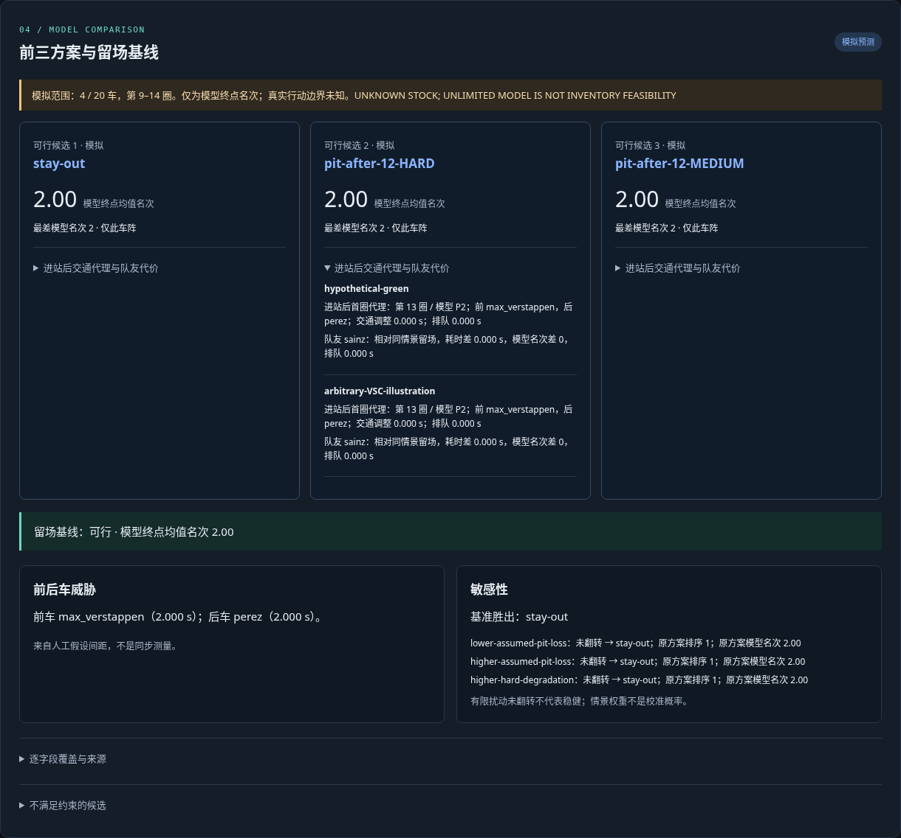
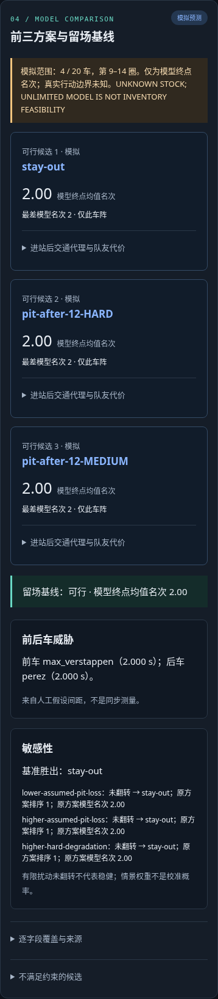

# Local workbench acceptance — 2026-10-17

[启动与使用](workbench.zh-CN.md) · [Machine-readable checks](workbench-acceptance.json)

The real browser journey passed on system Chromium through Playwright. The installed wheel
also started independently from `/tmp` and served its bundled assets, three real Bahrain
frozen decisions and explicit assumptions. The local workbench has no frontend framework,
account requirement, CDN or runtime data-download dependency.

| Check | Actual result |
|---|---|
| Desktop 1440×1000 and narrow 390×844 | No page overflow; narrow page scrollWidth = innerWidth = 390 |
| Real example | Leclerc, Bahrain 2023, 15:18 UTC; 20-driver frozen evidence |
| Manual comparison | Changed pit loss 22→18 seconds; three feasible rows and separate stay-out; 56 rollouts |
| Scope | Four-car, six-lap manual assumption model; horizon-end rank clearly labelled |
| Detail display | Initial threats, first-post-stop-lap traffic proxy, same-scenario teammate deltas and sensitivity |
| Reveal gate | No `/api/reveal` request until the explicit reveal button |
| Actual revealed lap | Fixed target lap 10, 99.073 seconds; median absolute error 0.409 seconds |
| Actual revealed gap report | 6.809 seconds; persistence absolute error 0.724 seconds |
| Export | 462,391-byte JSON with matching assumptions, original frozen hash, versions, source evidence and revealed observation |
| Selection/assumption changes | Old export disabled; changing UTC/driver clears revealed results; Hamilton template also simulated |
| Invalid JSON | Readable error, old simulation cannot be exported |
| Real process timeout | Dedicated server with 0.001-second limit killed the process; readable timeout, no export |
| Browser errors | None |
| Initial page ready | 0.310 seconds, measured from browser navigation |
| Comparison wall time | 1.234 seconds, including interaction/polling |
| Background process time | 0.37 seconds, reported by the server |

These are single-run local acceptance timings for the declared small example, not a real-time
service guarantee. Larger grids run in the background with elapsed-time feedback, cancellation
and a configurable process deadline. The server enforces at most two concurrent jobs and the
existing engine's cumulative rollout budget. No strategy benefit is factually validated by
the revealed observation targets.

One necessary full regression passed: **269 tests**, 31 pre-existing NumPy/pandas deprecation
warnings, 14.42 seconds. Ruff lint/format, JavaScript syntax, sdist/wheel build and isolated
wheel HTTP startup passed. The holdout adapter's country-name erratum is tested separately
because it was added after that complete regression; its results are in the holdout report.

Reproduce with `scripts/verify_workbench_browser.py` and the two-server commands in the guide.
Generated downloads, full screenshots, timeout screenshot, JUnit XML and build log remain in
`output/workbench-acceptance`. The following two screenshots are retained in the repository.

Desktop comparison:

Narrow-screen comparison:

## Additional actual-event integration

After holdout completion, `scripts/build_workbench_catalog.py` created a separate four-event
catalog with **72 frozen snapshots**, preserving the original bundled Bahrain sample. A focused
browser integration selected 2024 Britain, verified its 23 cutoffs, compared the manual model,
explicitly revealed Leclerc's actual target lap 6 (92.758 seconds, default absolute error
0.053 seconds), and exported both technical-erratum records with the matching 2024 frozen hash.
Comparison wall time was 0.874 seconds; no browser script errors occurred. Evidence is in
`output/workbench-acceptance/four-event-integration.json` and `british-decision-export.json`.
The numerical assumptions were not recalibrated to that race. This integration does not
replace the whole-event predictive evaluation.
